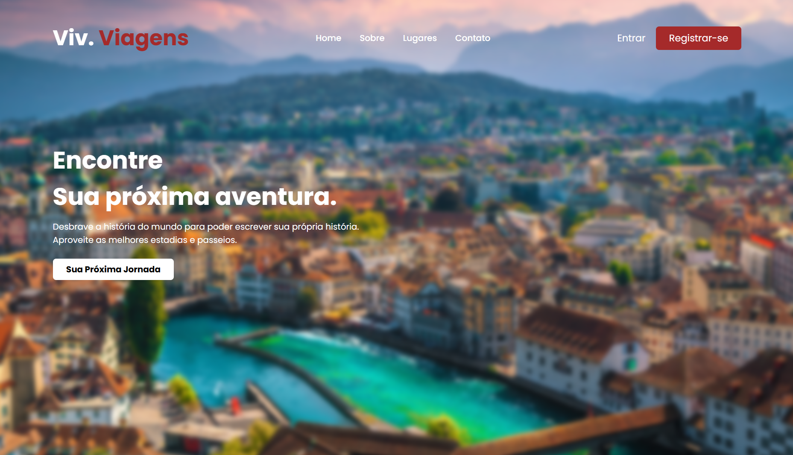

# 🌍 Site de Viagens — Viv. Viagens

Projeto de uma landing page de turismo, desenvolvido com **HTML5 e CSS3** como parte de uma atividade prática do curso PROA.

O projeto tem como objetivo explorar a criação de interfaces visuais para sites de viagens, trabalhando com imagens de fundo, organização de elementos, estilização de páginas e aplicação de efeitos visuais com CSS.

## 🖥️ Prévia do projeto

  

🔗 **[Acesse o projeto online](https://gabrielc0liveira.github.io/Projeto20Proa-SiteViagens/)**

## Funcionalidades e características

- Landing page com temática de turismo e viagens.
- Interface visual com imagem de fundo ocupando toda a tela.
- Efeito de desfoque aplicado à imagem de fundo.
- Menu de navegação horizontal.
- Identidade visual personalizada para a marca Viv. Viagens.
- Título principal em destaque com tipografia personalizada.
- Botões de entrada e registro na barra de navegação.
- Botão de chamada para ação "Sua Próxima Jornada".
- Efeitos de hover nos links e botões.
- Organização visual dos elementos com CSS.

## Tecnologias utilizadas

- **HTML5:** estruturação da página, menu de navegação, botões e conteúdo principal.
- **CSS3:** estilização, posicionamento, tipografia, efeitos visuais e configuração da imagem de fundo.
- **Google Fonts:** utilização da fonte Poppins.

## Aprendizados

Durante o desenvolvimento, foram praticados conceitos como:

- Estruturação de uma landing page utilizando HTML.
- Criação e estilização de menus de navegação.
- Aplicação de imagens de fundo com `background-image`.
- Utilização de `background-size: cover` e `background-position`.
- Organização de elementos utilizando Flexbox.
- Utilização de propriedades de posicionamento CSS.
- Aplicação de efeitos de desfoque com `filter: blur()`.
- Utilização de pseudoelementos como `::before`.
- Controle de sobreposição de elementos com `z-index`.
- Aplicação de transformações com `transform: scale()`.
- Criação de efeitos interativos utilizando `:hover`.
- Estilização de botões com cores, espaçamentos e bordas arredondadas.
- Utilização de medidas relativas para organização do layout.

## 📂 Como executar o projeto

🔗 **[Acesse o projeto online](https://gabrielc0liveira.github.io/Projeto20Proa-SiteViagens/)**

---

Desenvolvido por **Gabriel Oliveira** como parte das atividades práticas do PROA.
